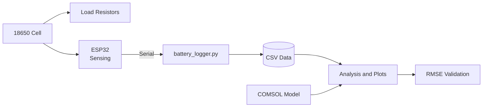

# Battery Digital Twin

A functional digital twin of a Li-ion 18650 cell. Real discharge data is logged from an ESP32 test rig, and a COMSOL simulation is validated against that data using RMSE.

<!-- Add a banner image or a cover photo of the rig here -->
<!--  -->

## Table of Contents

- [Overview](#overview)
- [Features](#features)
- [System Architecture](#system-architecture)
- [Hardware](#hardware)
- [Circuit Schematics](#circuit-schematics)
- [Software Setup](#software-setup)
- [Usage](#usage)
- [Validation (RMSE)](#validation-rmse)
- [Results](#results)
- [Project Structure](#project-structure)
- [Safety](#safety)
- [Roadmap](#roadmap)
- [Author](#author)
- [License](#license)

## Overview

This project connects a physical battery test rig to a physics-based simulation:

1. An **ESP32** measures the cell's voltage, current and temperature while it discharges through a resistive load.
2. A **Python** script (`battery_logger.py`) logs the measurements to CSV.
3. A **COMSOL** battery model is run under the same conditions.
4. Simulated and measured curves are compared using **RMSE** to check how closely the model matches the real cell.

The goal is a digital twin: a model that tracks the real cell's behaviour closely enough to predict it.

## Features

- Real-time logging of voltage, current and temperature from an ESP32 to CSV
- State of Charge (SoC) logging and plotting *(in progress)*
- Multi-cycle charge/discharge characterisation (voltage and current vs time)
- COMSOL simulation of the same cell and load profile
- Quantitative model validation using RMSE

## System Architecture



## Hardware

| Component | Details |
|---|---|
| Microcontroller | ESP32 |
| Cell | Panasonic 18650 Li-ion cell, in a battery holder |
| Load | 2 x wirewound power resistors (discharge load) |
| Assembly | Breadboard |
| Sensing | TODO: voltage divider / current sensor / temperature sensor (add part numbers) |

### Pin Connections

<!-- Fill in with your actual wiring -->

| ESP32 Pin | Connected To | Purpose |
|---|---|---|
| TODO | TODO | Cell voltage sense |
| TODO | TODO | Current sense |
| TODO | TODO | Temperature sensor |
| GND | Common ground | Reference |

## Circuit Schematics

<!-- Export your schematic from KiCad / EasyEDA / Fritzing / Falstad as PNG or SVG
     and save it in docs/images/. Then the images below will render. -->

### Full Circuit


### Discharge Load Circuit


### Sensing Circuit


### Breadboard Layout


**Component values**

| Ref | Part | Value |
|---|---|---|
| BT1 | Panasonic 18650 | 3.7 V nominal |
| R1, R2 | Wirewound power resistor | TODO ohm / TODO W |
| U1 | ESP32 dev board | TODO model |

## Software Setup

### Requirements

- Python 3.9+
- COMSOL Multiphysics (with the Battery Design Module)
- Arduino IDE or PlatformIO, for flashing the ESP32

### Install

```bash
git clone https://github.com/<your-username>/<repo-name>.git
cd <repo-name>
pip install pyserial pandas numpy matplotlib
```

### Flash the ESP32

1. Open the firmware in `firmware/`.
2. Select your ESP32 board and port.
3. Upload.

## Usage

### 1. Log data

Connect the ESP32 and set the serial port in `battery_logger.py` (default `COM5` on Windows):

```bash
python battery_logger.py
```

This writes timestamped voltage, current and temperature readings to a CSV file.

### 2. Plot measured data

```bash
python plot_cycles.py data/discharge_log.csv
```

### 3. Run the COMSOL model

Open `comsol/battery_model.mph`, set the load to match your resistors, and run the study. Export the results as CSV.

### 4. Compare

```bash
python compute_rmse.py data/discharge_log.csv comsol/results.csv
```

## Validation (RMSE)

Model accuracy is measured with the root mean square error between measured and simulated voltage:

```
RMSE = sqrt( (1/N) * sum( (V_measured - V_simulated)^2 ) )
```

A lower RMSE means the simulation tracks the real cell more closely.

## Results

<!-- Add your plots and numbers once you have them -->

| Metric | Value |
|---|---|
| Voltage RMSE | TODO |
| Test conditions | TODO (load, temperature, cycles) |


## Project Structure

```
.
├── battery_logger.py     # Serial logger: ESP32 -> CSV
├── firmware/             # ESP32 code
├── comsol/               # COMSOL model files
├── data/                 # Logged CSV data
├── docs/
│   └── images/           # Schematics, photos, result plots
└── README.md
```

## Safety

Lithium-ion cells can overheat, vent or catch fire if misused.

- Do not discharge below the cell manufacturer's minimum voltage.
- Check that your resistors are rated for the power they dissipate (P = V x I).
- Do not leave the rig running unattended.
- Use a proper holder and avoid short circuits.

## Roadmap

- [ ] Log State of Charge alongside voltage, current and temperature
- [ ] Plot SoC in COMSOL
- [ ] Multi-cycle characterisation plots from real data
- [ ] Reduce RMSE by tuning model parameters

## Author

**G-One**, Electronics and Communication Engineering, VIT Bhopal

## License

MIT. See [LICENSE](LICENSE).
